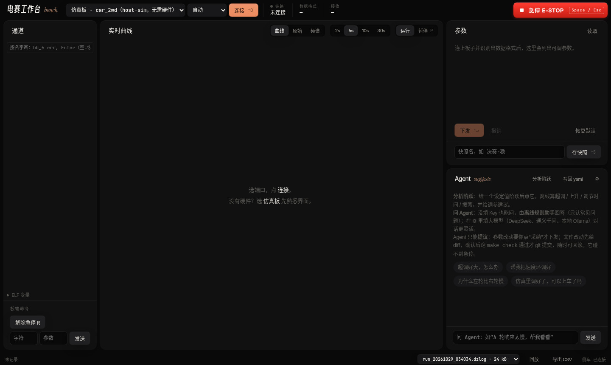
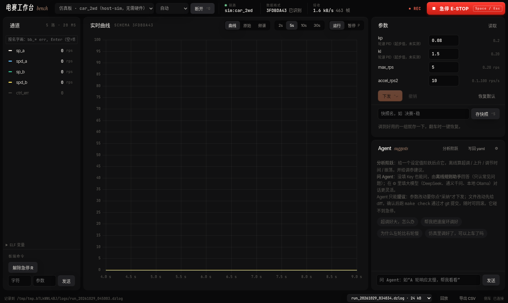
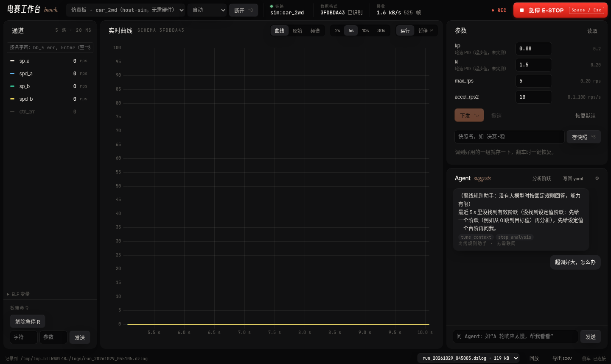
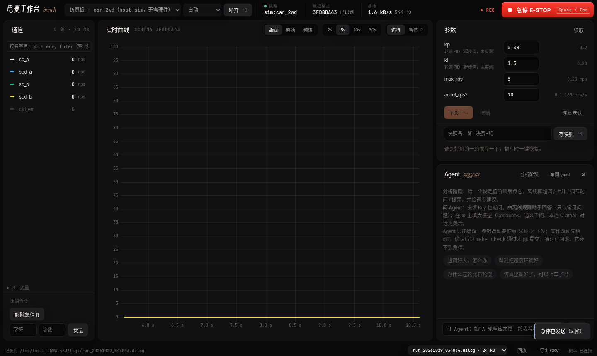

# 00 快速上手（从装软件到调好 PID）

> 写给第一次用的同学：照着做一遍，能把自己的 CubeMX 工程接上电赛工作台、烧录、连上、用 Agent 调参、会处理急停。
> 标注：【仿真】= 截图来自仓库里的仿真板（host-sim 跑真实固件逻辑），界面与真板一致；【未验证】= 作者没有在 Windows / Keil / 真板上走过这一步，请按实际界面为准，有出入提 issue。

**只想先看看**：装好（§1）→ 端口选“仿真板 · car_2wd”→ 连接 → 按急停。不用板子，5 分钟。
**接自己的板**：§2 生成板卡表 → §3 Keil 加模块 → §4 烧录 → §5 连接 → §6 调参。遇到急停看 §7。

## 0. 你需要
- Windows 10/11 电脑；STM32 板（F1/F4 已适配，例如天空星 F407）+ ST-Link 或 DAPLink；两轮小车或电机+编码器。
- 用 MSPM0（天猛星）的：§2–§4 换成 [10 SysConfig](10-SysConfig工作流.md) + [15 CCS](15-CCS工作流.md)，§5 起相同。
- STM32CubeMX、Keil MDK 5（Arm Compiler 6）；Python 3.10+（生成板卡表、注入工程用）。
- 本仓库：`git clone` 或在 GitHub 页面 Code → Download ZIP。

## 1. 安装工作台（exe）【未验证】
1. 打开仓库 GitHub 页 → **Releases** 或 **Actions → app-windows** → 最新一次成功运行 → 下载 artifact **dzbench-windows**（zip 里是 NSIS 安装包 `电赛工作台_x.y.z_x64-setup.exe`）。
2. 双击安装（未签名，SmartScreen 提示时点“更多信息 → 仍要运行”）。装好后开始菜单里有“电赛工作台”。
3. 先不接板子打开看一眼；插上 ST-Link 虚拟串口或 USB-TTL 后，端口下拉框里会出现 `COMx`。
4. 双击两次只会有一个窗口；后台侧车意外退出会自己重启，界面有提示。


*【仿真】刚启动，左上角选端口，右上角红色是急停。*

> 没有 Windows 也能先体验：Linux / macOS 上 `PYTHONPATH=app/sidecar python3 -m dzbench --ui app/ui/dist`，浏览器打开 http://127.0.0.1:8766/ ，端口选“仿真板 · car_2wd”。

## 2. 准备 CubeMX 工程
1. 用 CubeMX 打开（或新建）你的 .ioc，按约定给引脚起 **User Label**：`PWM_L`/`PWM_R`、`ENC_L_A`/`ENC_L_B`、`UART_LINK_TX`/`_RX`、`GPIO_LED` 等（完整规则见 [05 CubeMX 工作流](05-CubeMX工作流.md)）。
2. 必须的设置：NVIC 分组 4、用到的 UART/DMA/TIM 中断打开、调试串口 RX 用 Circular DMA。
3. Project Manager → Toolchain 选 **MDK-ARM**，Generate Code。
4. 让工具检查并生成板卡描述：
   ```sh
   python3 tools/ioc_import.py 你的工程/xxx.ioc --base boards/stm32f407-skystar-cubemx/board.yaml -o boards/我的板/board.yaml
   make ioc-check
   make BOARD=我的板 APP=car_2wd gen        # 生成 build/我的板/gen/board_gen.{h,c}
   ```
   报错时按提示改 .ioc 再生成（规则编号 T1/N1/D2… 在 docs/05 表里）。

## 3. 在 Keil 里加模块【未验证：未在 µVision 打开过】
1. 关掉 Keil，运行注入（可重复运行，只动 `dz/` 开头的组，原文件备份 `.bak`）：
   ```sh
   python3 tools/keil_inject.py 你的工程/MDK-ARM/xxx.uvprojx \
     --module firmware/algo/pid --module firmware/drivers/motor_dc --module firmware/drivers/encoder \
     --module firmware/proto/dzframe --module ports/stm32-cubemx \
     --extra-src build/我的板/gen/board_gen.c --extra-inc build/我的板/gen --extra-inc apps/include \
     --extra-src apps/car_2wd/app_main.c
   ```
   依赖的模块（pal、common…）会自动补上；28 个模块都由 `make check` 的 test_module_ide 验证过能注入并通过语法检查。
2. 在 CubeMX 生成的 `main.c` 的 `USER CODE` 区加三行接缝：Includes 区 `#include "dz_cubemx.h"`、USER CODE 2 区 `dz_cubemx_start();`、USER CODE 3 区（主循环）`dz_cubemx_loop();`（FreeRTOS 写法见 docs/05）。
3. 原工程若有同名的 `HAL_UART_RxCpltCallback` / `HAL_GPIO_EXTI_Callback`，删掉或改成转发（EXTI 可定义 `DZ_CM_NO_EXTI_CALLBACK` 后在自己的回调里调 `dz_cm_gpio_exti(pin)`）。
4. 打开 Keil → Build（F7），0 error 即可。

## 4. 烧录：ST-Link 或 DAPLink【未验证】
- Keil：Options for Target → **Debug** 选 `ST-Link Debugger` 或 `CMSIS-DAP Debugger`（DAPLink）→ Settings 里能看到芯片 IDCODE 才算连上 → **Utilities** 勾“Use Debug Driver” → Download（F8）。
- 连不上：SWDIO/SWCLK/GND 三根线、板子单独供电、Settings 里 Connect 改 “under Reset”、降低 SWD 时钟到 1 MHz。
- 板子 LED 每 500 ms 闪一下 = 固件在跑、心跳在发。

## 5. 连接工作台
1. 串口：ST-Link V2-1 / DAPLink 自带虚拟串口（VCP）可直接用；否则用 USB-TTL 接板子 `UART_LINK` 的 TX↔RX、**GND 必接**。
2. 工作台选对应 `COMx`，波特率默认 115200（与 board.yaml 一致），点 **连接**。
3. 顶栏“链路”绿点、“数据格式 已识别”、右侧出现参数表 = 成功。“数据格式找不到”时按提示在仓库里 `make BOARD=我的板 APP=car_2wd` 一次（工作台靠它生成的 link_schema.json 认板子）。
4. 拔线后电机 1 秒内停；插回会自动重连，但**车不会自己动**，按 R 才恢复。换了 USB 口也会跟过去；两块同型号板同时插着时只认原来那块（靠固件心跳里的芯片 ID），认不出就提示你手动选端口。【仿真】


*【仿真】左边是通道（sp_a 设定值、spd_a 实测转速…），中间曲线，右边参数和 Agent。*

## 6. 用 Agent 调 PID
1. 先让小车**架空**（轮子离地）。在参数区把目标速度给一个阶跃（或底部“板端命令”发设定值），看曲线。
2. 点 Agent 区的快捷问题，如“超调好大，怎么办”，或直接输入“A 轮响应太慢，帮我看看”。
3. Agent 读最近几秒曲线做阶跃分析，给出 kp/ki 建议，以“参数提议”卡片出现（已按 schema 限幅）；**它只建议，不会自己下发**——你在卡片上点“采纳”才下发到板子。也可以自己在参数框改值点 **下发**，不满意点“撤销”。
4. 调好后在“快照名”里写名字点 **存快照**；比赛当天一键恢复。
5. 没配大模型 Key 时是离线规则助手（能力有限）；右上角 ⚙ 可填 DeepSeek / 通义 / 本地 Ollama。想知道某个模型靠不靠谱：`make agent-eval`（见 docs/18 §3.3，【未测】）。


*【仿真】没有阶跃时 Agent 会先让你给一个阶跃再分析。*

## 7. 急停
- **按右上角红色“急停 E-STOP”或键盘 Space / Esc**：板子立即停电机并锁存（ESTOP 状态），工作台锁住所有发送。
- 锁存是故意的：Agent 和任何自动化**都不能**解除急停。确认安全（小车拿稳、参数改回去）后，由你手动点左下角 **解除急停 R**（发 CMD 'R'）或重新连接。
- 板端自己也会急停：心跳/串口超时、电池从正常掉到危险电压（配了 VBAT 时）。原因看顶栏提示。
- 曲线不动 / 电机不转，先看是不是处在急停。


*【仿真】右下角提示“急停已发送”。*

## 8. 下一步
- 换板只改引脚：[06 新增板卡](06-新增板卡.md)。
- 视觉板（Jetson / 树莓派 / MaixCAM / K230）发识别结果：[22 协处理器发送库](22-协处理器发送库.md)。
- 工作台全部功能：[17 桌面工作台](17-桌面工作台.md)、[18 内置 Agent](18-内置Agent.md)。
